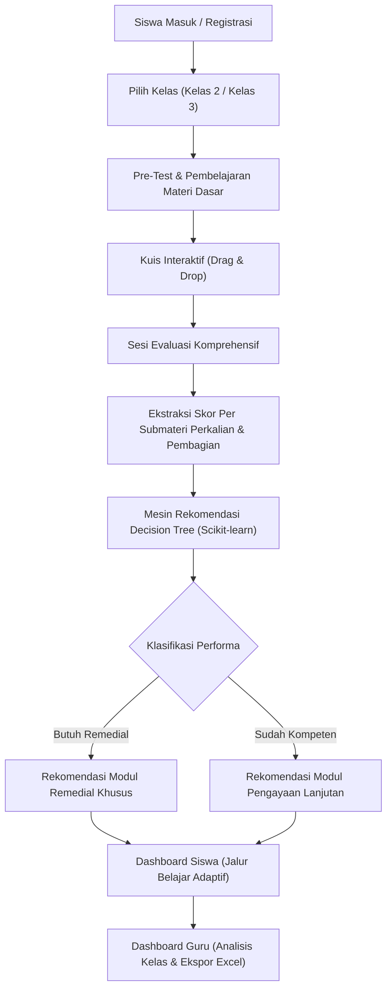

# Bimbaka

> **Platform Web Pembelajaran Matematika Adaptif Berbasis Rekomendasi Machine Learning (Decision Tree) untuk Sekolah Dasar.**  
> *An adaptive primary school mathematics web-learning platform powered by a Machine Learning (Decision Tree) recommendation engine.*

[](https://www.python.org/)
[](https://www.djangoproject.com/)
[](https://www.gnu.org/licenses/agpl-3.0)
[](https://github.com/Fika-Fifrost/TA_Bimbaka/releases/tag/v1.0.0)
[](https://openlibrary.telkomuniversity.ac.id/home/catalog/id/248686/slug/implementasi-algoritma-decision-tree-untuk-rekomendasi-materi-belajar-pada-website-pembelajaran-matematika-topik-perkalian-dan-pembagian-dalam-bentuk-buku-karya-ilmiah.html)

---

## Executive Summary (English)

**Bimbaka** is an interactive web-based educational platform engineered to enhance mathematical learning outcomes for elementary school students (Grades 2 & 3), specifically focusing on multiplication (*perkalian*) and division (*pembagian*). Developed with **Django 6.0** and **Scikit-learn**, Bimbaka incorporates an intelligent **Decision Tree Classification** engine that analyzes each student's diagnostic evaluation scores and automatically recommends personalized remedial or enrichment learning modules.

---

## Latar Belakang & Konteks Penelitian Skripsi

Perangkat lunak ini merupakan luaran implementasi dari karya ilmiah / Skripsi program studi S1 Teknik Informatika di **Telkom University Purwokerto** oleh **Fika Qoshdina**:

- **Judul Skripsi:** *Implementasi Algoritma Decision Tree untuk Rekomendasi Materi Belajar pada Website Pembelajaran Matematika Topik Perkalian dan Pembagian*
- **Studi Kasus:** Siswa Kelas 2 dan Kelas 3 di **SD Negeri 02 Sastrodirjan**
- **Katalog Resmi:** [Open Library Telkom University #248686](https://openlibrary.telkomuniversity.ac.id/home/catalog/id/248686/slug/implementasi-algoritma-decision-tree-untuk-rekomendasi-materi-belajar-pada-website-pembelajaran-matematika-topik-perkalian-dan-pembagian-dalam-bentuk-buku-karya-ilmiah.html)
- **Repositori Resmi Upstream:** [Fika-Fifrost/TA_Bimbaka](https://github.com/Fika-Fifrost/TA_Bimbaka)

### Permasalahan & Solusi
Rendahnya pemahaman konsep dasar perkalian dan pembagian pada siswa sekolah dasar sering kali disebabkan oleh pendekatan pembelajaran yang bersifat seragam tanpa diagnosis kelemahan spesifik per topik. Bimbaka memecahkan permasalahan ini dengan:
1. Melakukan asesmen diagnostik otomatis melalui pre-test dan evaluasi berkala.
2. Mengklasifikasikan performa siswa menggunakan model **Decision Tree** terlatih (`model_kelas_2.joblib` dan `model_kelas_3.joblib`).
3. Menghasilkan jalur rekomendasi materi belajar yang terpersonalisasi secara instan bagi setiap siswa.

---

## Alur Pembelajaran & Mesin Rekomendasi (End-to-End Flow)



---

## Fitur Utama

- **Pembelajaran Adaptif Berjenjang:** Kurikulum matematika terstruktur untuk Kelas 2 dan Kelas 3 dengan submateri perkalian dan pembagian.
- **Kuis Interaktif Drag & Drop:** Evaluasi berbasis permainan visual yang mempermudah pemahaman konsep anak sekolah dasar.
- **Mesin Klasifikasi Decision Tree:** Model prediktif yang dilatih untuk memberikan saran materi spesifik sesuai pola jawaban salah/benar siswa.
- **Dashboard Guru Terpadu:**
  - Manajemen kuis (tambah, edit, hapus soal dan materi).
  - Monitoring statistik kemajuan belajar siswa secara riil.
  - Ekspor rekapitulasi nilai dan hasil evaluasi ke format Excel (`.xlsx`).
- **Dashboard Siswa:** Riwayat capaian nilai, lencana latihan, dan daftar materi belajar yang dipersonalisasi.

---

## Arsitektur Direktori Proyek

```text
bimbaka/
├── belajar/                    # Aplikasi utama logika bisnis dan antarmuka
│   ├── migrations/             # Berkas migrasi database Django
│   ├── ml_models/              # Model Decision Tree terlatih (.joblib)
│   ├── templates/              # Berkas template antarmuka HTML
│   ├── admin.py                # Konfigurasi Django Admin
│   ├── forms.py                # Validasi formulir pengguna dan kuis
│   ├── models.py               # Model database (Materi, Evaluasi, Kuis)
│   ├── urls.py                 # Routing URL aplikasi belajar
│   └── views.py                # Handler view dan integrasi inferensi ML
├── bimbaka/                    # Konfigurasi inti proyek Django
│   ├── settings.py             # Konfigurasi aplikasi, database, dan security
│   ├── urls.py                 # Root URL routing
│   └── wsgi.py                 # Entry point WSGI untuk deployment
├── AGENTS.md                   # Pedoman operasional agen AI (AAIF Standard)
├── CHANGELOG.md                # Catatan riwayat rilis (Keep a Changelog & SemVer)
├── LICENSE                     # Lisensi open-source GNU AGPLv3
├── NOTICE                      # Atribusi karya ilmiah skripsi & format sitasi
├── pyproject.toml              # Metadata proyek Python dan linter config
├── requirements.txt            # Daftar dependensi modul Python
└── reset_db.bat                # Skrip otomatis reset database lokal SQLite
```

---

## Prerequisites

Pastikan lingkungan kerja memenuhi kebutuhan versi runtime minimum berikut:

- **Python:** `>= 3.12`
- **Pip:** `>= 23.0`
- **Git:** `>= 2.40`
- **Database:** SQLite (bawaan pengembangan lokal) atau PostgreSQL (produksi)

---

## Quick Start (Instalasi & Menjalankan Lokal)

Ikuti langkah-langkah di bawah ini untuk menjalankan Bimbaka di komputer lokal dalam waktu kurang dari 1 menit:

```bash
# 1. Clone repositori
git clone https://github.com/Fika-Fifrost/TA_Bimbaka.git
cd TA_Bimbaka

# 2. Buat dan aktifkan virtual environment
python -m venv .venv
# Di Windows (PowerShell):
.venv\Scripts\Activate.ps1
# Di Linux / macOS:
source .venv/bin/activate

# 3. Pasang seluruh dependensi proyek
pip install -r requirements.txt

# 4. Jalankan migrasi database
python manage.py migrate

# 5. Buat akun administrator (Guru/Admin)
python manage.py createsuperuser

# 6. Jalankan server pengembangan lokal
python manage.py runserver
```

Buka peramban (browser) dan akses:
- **Aplikasi Siswa/Guru:** [http://127.0.0.1:8000/](http://127.0.0.1:8000/)
- **Panel Django Admin:** [http://127.0.0.1:8000/admin/](http://127.0.0.1:8000/admin/)

---

## Environment Variables

Bimbaka mendukung konfigurasi berbasis berkas `.env` untuk kebutuhan deployment maupun konfigurasi lokal:

| Variable | Description | Default | Required |
| :--- | :--- | :--- | :--- |
| `DEBUG` | Mengaktifkan mode debug Django (`True` / `False`) | `True` | Opsional |
| `SECRET_KEY` | Kunci enkripsi kriptografi sesi Django | Default Dev Key | Ya (di Produksi) |
| `ALLOWED_HOSTS` | Daftar hostname yang diizinkan (dipisah koma) | `localhost,127.0.0.1` | Opsional |
| `DATABASE_URL` | Koneksi database PostgreSQL (format dj-database-url) | SQLite lokal | Opsional |

---

## Usage

### 1. Alur Akses Siswa
1. Akses halaman pendaftaran (`/register/`) dan pilih tingkatan kelas (Kelas 2 atau Kelas 3).
2. Selesaikan pre-test atau langsung pelajari materi yang tersedia di menu **Materi**.
3. Kerjakan kuis interaktif dan sesi evaluasi.
4. Akses halaman **Hasil Evaluasi** untuk melihat skor dan modul rekomendasi materi dari algoritma Decision Tree.

### 2. Alur Akses Guru
1. Masuk menggunakan akun bertipe guru atau administrator.
2. Buka **Dashboard Guru** untuk melihat daftar siswa, perkembangan kemajuan belajar, dan rekapitulasi nilai kuis.
3. Gunakan tombol **Ekspor Excel** untuk mengunduh rekap nilai siswa ke format spreadsheet.
4. Kelola bank soal dan kuis melalui menu manajemen kuis terintegrasi.

---

## Testing & QA

Untuk menjalankan pengujian kualitas dan verifikasi test suite Django:

```bash
# Menjalankan seluruh test suite
python manage.py test

# Menjalankan pengujian spesifik per fungsi/kelas
python manage.py test belajar.tests

# Melakukan formatting kode Python
black .

# Melakukan linter dan reformatting template HTML Django
djlint . --reformat
```

---

## Contributing

Kontribusi pada repositori ini diatur melalui protokol kerja agen AI dan pengembang:
1. Seluruh pedoman kontribusi, aturan commit atomik, konvensi branch, dan pengujian dapat dilihat pada [`AGENTS.md`](AGENTS.md).
2. Setiap perubahan fitur atau perbaikan bug wajib dikerjakan pada branch terpisah dan diajukan melalui Pull Request.
3. Seluruh pembaruan wajib dicatat pada [`CHANGELOG.md`](CHANGELOG.md) di bawah seksi `## [Unreleased]`.

---

## License & Academic Attribution

### Lisensi Perangkat Lunak
Proyek ini dilisensikan di bawah **GNU Affero General Public License v3.0 (GNU AGPLv3)**. Ketentuan lengkap lisensi dapat dibaca pada berkas [`LICENSE`](LICENSE).

### Hak Cipta & Sitasi Akademik
Seluruh kode sumber dan kekayaan intelektual aplikasi ini dimiliki secara mutlak oleh:
- **Penulis:** Fika Qoshdina (<qoshdinafika@gmail.com>)
- **Institusi:** Program Studi S1 Teknik Informatika, Telkom University Purwokerto (2026).

Untuk merujuk atau mengutip perangkat lunak ini dalam riset ilmiah, mohon gunakan format sitasi yang tercantum pada berkas [`NOTICE`](NOTICE).
